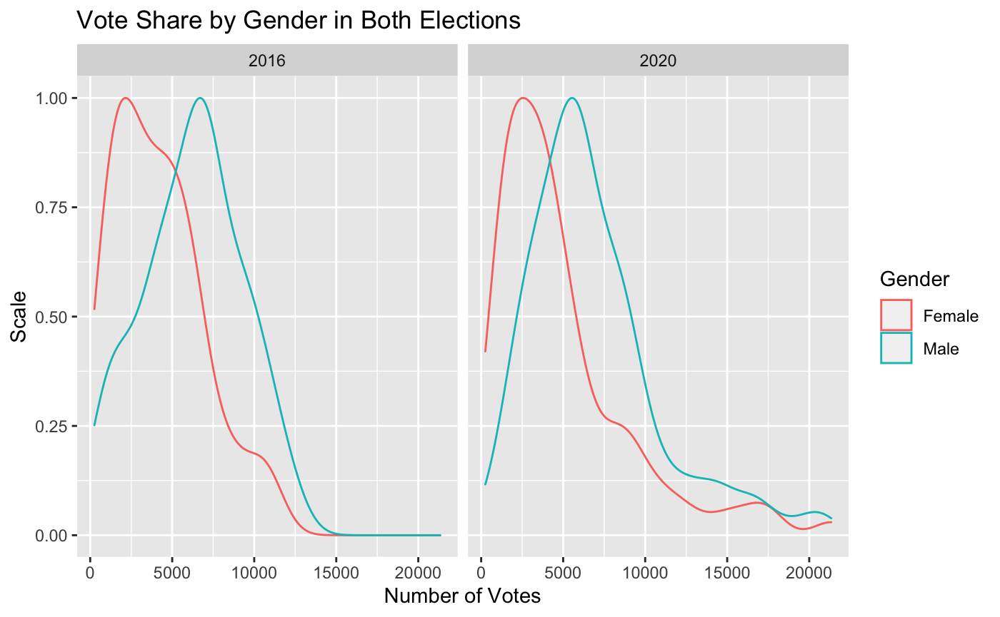
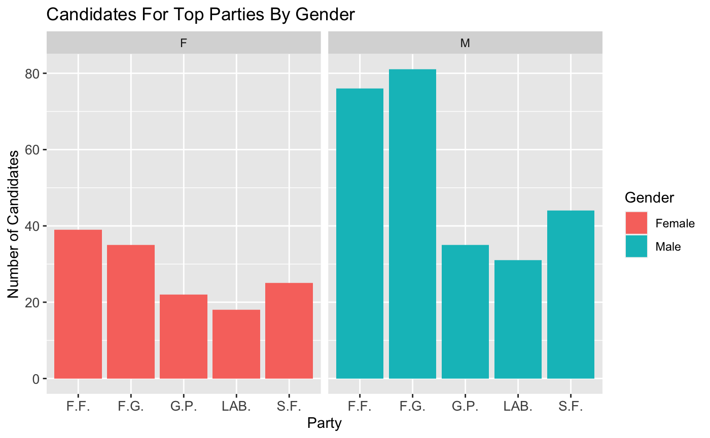
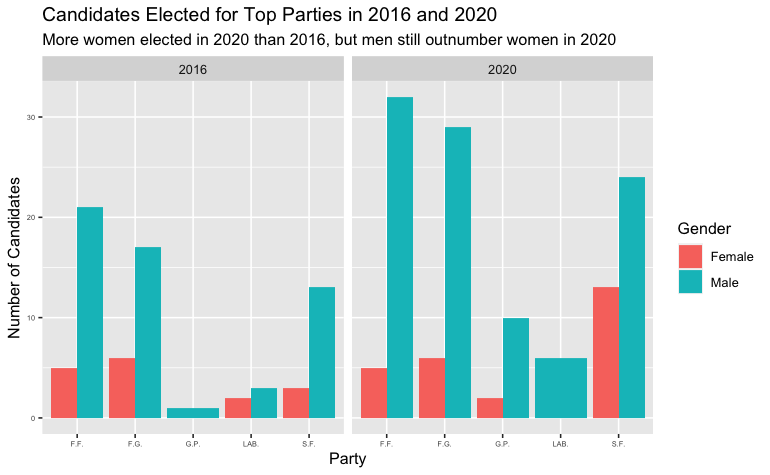
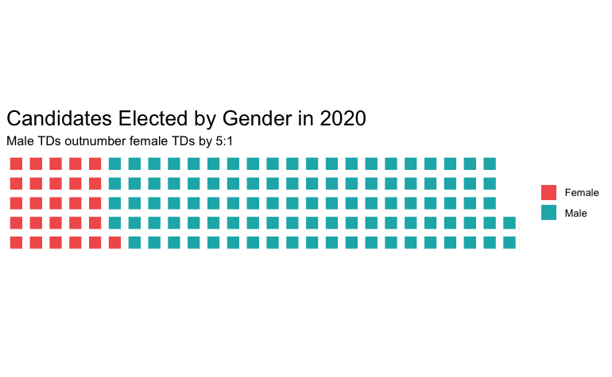

# Irish General Election Gender Breakdown, 2016–2020

Data visualisation in R: the gender breakdown of candidates and TDs in the 2016 and 2020 Irish general elections, using candidate data from the Department of Housing, Local Government and Heritage.

## The questions

1. What was the vote share for female candidates?
2. Which parties fielded the most female TDs under the gender quota?
3. Which parties improved between 2016 and 2020?

## Findings

- Women were about 30% of candidates in both elections, but only 22% (35) of the TDs elected in 2016 were women — up from 15% in 2011, after the gender quota law came in. The 2020 election returned 36 women (22.5%).
- The median female candidate won 4,216 votes in 2016 and 3,708.5 in 2020; the median male candidate won 6,469 and 6,036.5.
- Among the top five parties (Fianna Fáil, Fine Gael, Green Party, Labour, Sinn Féin), men outnumbered women roughly 2-to-1 as candidates in Fianna Fáil and Fine Gael in both elections.
- More women were elected in 2020 than in 2016, but men still outnumbered them — in the top five parties, 26 women and 101 men were elected in 2020.

## Insight 1 — Vote share by gender

The density plot shows female candidates clustered at lower vote counts than male candidates in both elections, with the gap barely narrowing between 2016 and 2020.



The party-level medians moved a lot more than the gender gap did. Sinn Féin's median vote doubled (6,066 → 12,620) and the Green Party's nearly tripled (1,331 → 3,650), while Labour's halved (4,182 → 2,208) and Fianna Fáil (6,950 → 5,503) and Fine Gael (6,419 → 5,447) both fell.

## Insight 2 — Candidates fielded by the top five parties

Fianna Fáil and Fine Gael fielded the most candidates of either gender; the gender split within each party is shown below.



## Insight 3 — Candidates elected

More women were elected in 2020 than in 2016, but the gap stayed wide. The waffle chart covers the top five parties only.





## Conclusion

The gender quota lifted the share of women standing — about 30% of candidates in both elections — but the share elected lagged well behind it: 22% of TDs in 2016 (35 women) and 22.5% in 2020 (36 women). Standing isn't the same as winning.

The vote-share gap barely moved between the two elections. The median female candidate won 4,216 votes in 2016 and 3,708.5 in 2020, against 6,469 and 6,036.5 for the median male candidate — female candidates still cluster at lower vote counts in both years.

Within the top five parties the pattern was stable: men outnumbered women roughly 2-to-1 as candidates in Fianna Fáil and Fine Gael in both elections, and while more women were elected in 2020 than in 2016, men still outnumbered them 101 to 26 across those parties. Progress on paper hasn't translated proportionally into seats.

## Method

The analysis is in `analysis/irish-election-gender.Rmd` (R, ggplot2). It covers cleaning (missing results dropped, column names aligned, party names fixed — including fáda/mojibake fixes such as "Fianna F�il" → "Fianna Fáil"), then three visualisations, with the earlier iterations kept in the Rmd so the reasoning is visible: histograms and boxplots first, then the density plot; fixed versus free scales compared before settling on fixed scales so the two years are directly comparable.

## Data

`data/candidates-2016.csv` (551 rows) and `data/candidates-2020.csv` (531 rows): candidate lists for the 2016 and 2020 general elections, as published by the Department of Housing, Local Government and Heritage. Public data, included in the repo so the analysis runs without a live source.

## Reproduce

```r
# install.packages(c("ggpubr", "dplyr", "car", "psych", "Hmisc",
#                    "ggplot2", "gmodels", "tidyverse", "janitor",
#                    "hrbrthemes", "extrafont", "waffle"))
rmarkdown::render("analysis/irish-election-gender.Rmd")
```

## Notes

- Candidate counts quoted in the analysis are counts after cleaning (rows with a missing result were dropped), not the official totals.
- The waffle chart covers the top five parties only, not all elected TDs — the 36 women elected in 2020 is the overall figure.
- Originally written in 2021 as coursework (TU Dublin, MSc Computer Science — Data Science). The analysis is unchanged; the assignment framing and student number have been removed, and the data now loads from local files in `data/` instead of the original live URLs. A clean re-run in a current R version has not been verified.

## Licence

MIT. See [LICENSE](LICENSE).
